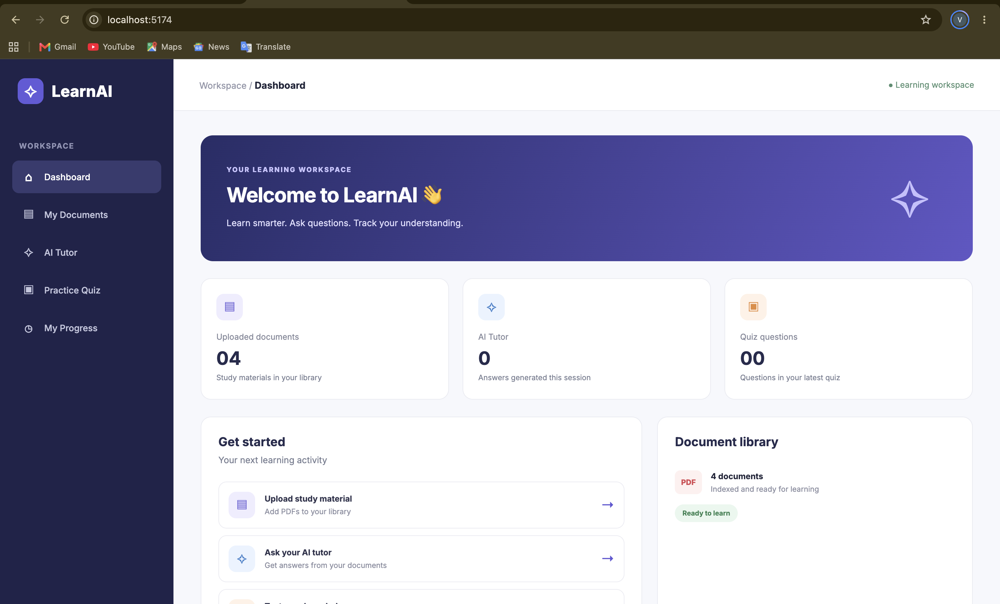
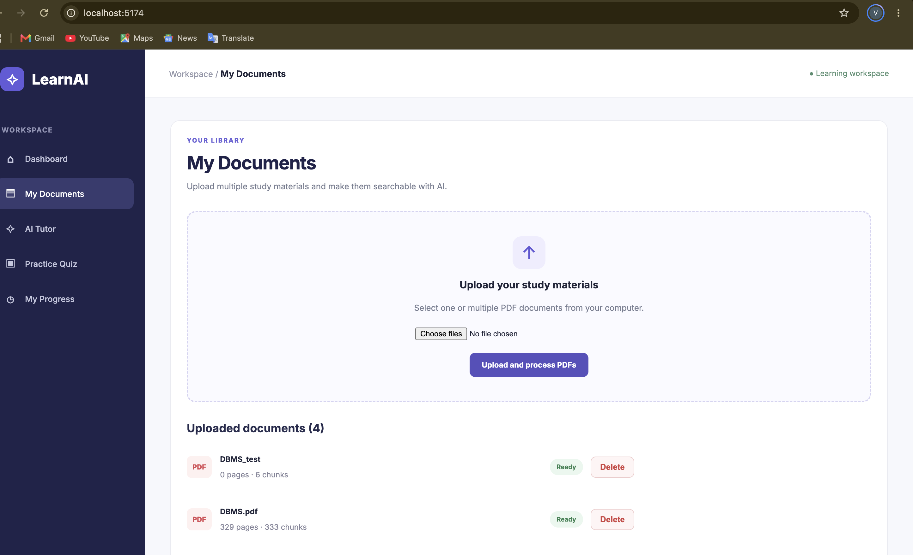
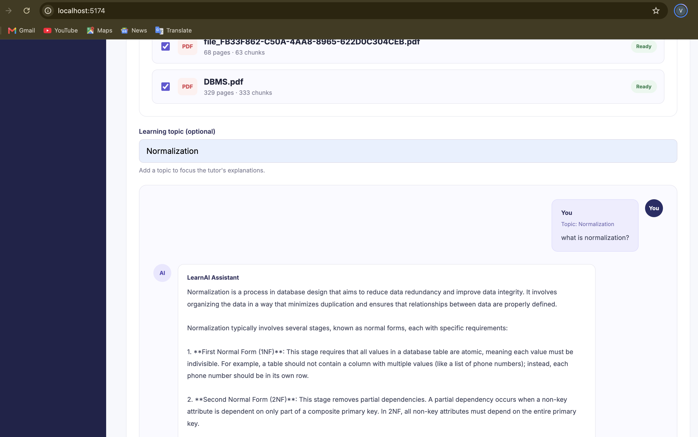
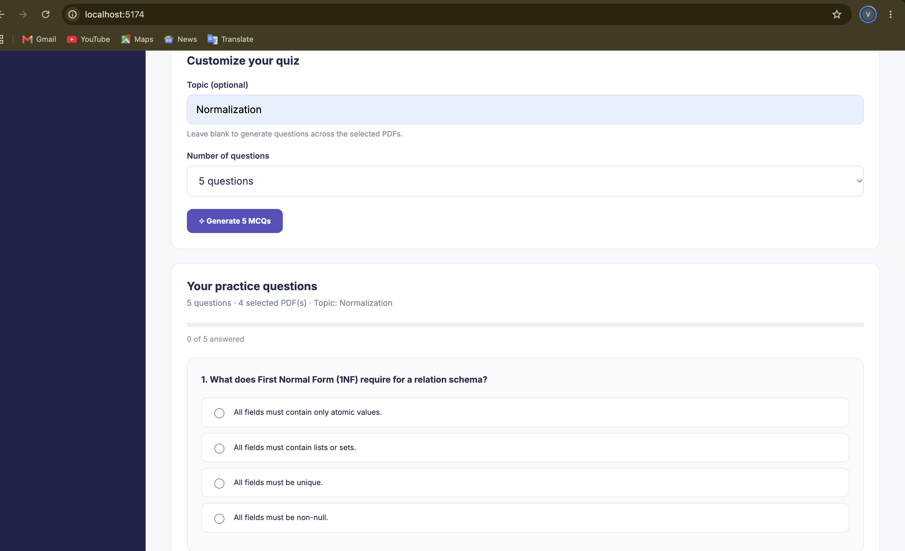
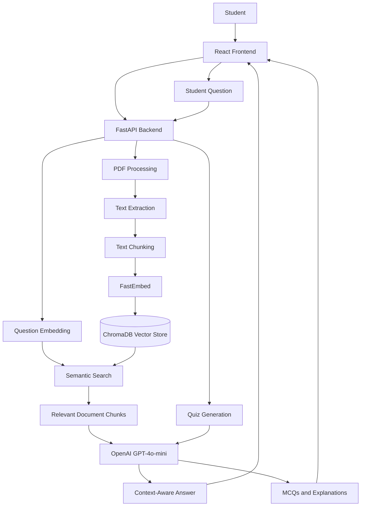

# LearnAI – AI-Powered Learning Companion

LearnAI is an AI-powered learning companion designed to make studying academic materials more interactive and accessible. Students can upload PDF documents, ask questions about their learning materials, explore specific topics, and generate quizzes to test their understanding.

The project uses Retrieval-Augmented Generation (RAG) to provide context-aware answers grounded in uploaded documents.

## Application Screenshots

### 1. LearnAI Dashboard


### 2. Document Library


### 3. AI Tutor – RAG-Based Question Answering


### 4. AI-Generated Practice Quiz


## Key Features

- **PDF Document Upload:** Upload and manage academic PDF materials.
- **Document-Based Q&A:** Ask questions and receive AI-generated answers based on uploaded documents.
- **RAG Pipeline:** Retrieve relevant document chunks before generating answers.
- **Page References:** View source references associated with answers.
- **AI Tutor:** Explore specific topics through focused AI-assisted explanations.
- **Quiz Generation:** Generate multiple-choice quizzes with 5, 10, 15, or 20 questions.
- **Answer Evaluation:** Submit quizzes to receive scores and explanations.
- **Document Management:** View, select, and delete uploaded documents.

## Technology Stack

| Component | Technologies |
|---|---|
| Frontend | React, JavaScript, CSS |
| Backend | Python, FastAPI |
| LLM | OpenAI GPT-4o-mini |
| Embeddings | FastEmbed |
| Vector Database | ChromaDB |
| Numerical Processing | NumPy |
| Document Processing | PDF text extraction |

## System Architecture

1. **Document Ingestion:** Users upload academic PDF documents.
2. **Text Extraction:** Text is extracted from uploaded PDFs along with page information.
3. **Text Chunking:** Extracted text is divided into smaller chunks.
4. **Embedding Generation:** FastEmbed generates vector embeddings for text chunks.
5. **Vector Storage:** ChromaDB stores embeddings and associated document metadata.
6. **Retrieval:** Relevant chunks are retrieved based on the user's question.
7. **Response Generation:** Retrieved context is passed to OpenAI GPT-4o-mini to generate a context-aware response.

### RAG Architecture Diagram



## Project Structure

```text
LearnAI/
├── backend/
│   ├── main.py
│   ├── embedding_service.py
│   ├── pdf_processor.py
│   ├── qa_service.py
│   ├── quiz_service.py
│   ├── text_chunker.py
│   ├── vector_store.py
│   └── requirements.txt
│
├── frontend/
│   ├── src/
│   │   ├── App.jsx
│   │   ├── App.css
│   │   ├── index.css
│   │   └── main.jsx
│   ├── package.json
│   └── index.html
│
├── screenshots/
│   ├── dashboard.png
│   ├── document-library.png
│   ├── ai-tutor.png
│   └── quiz.png
│
└── README.md
```

## Getting Started

### Prerequisites

- Python 3.10 or later
- Node.js and npm
- OpenAI API key

### 1. Clone the Repository

```bash
git clone https://github.com/Devgan06/LearnAI.git
cd LearnAI
```

### 2. Set Up the Backend

```bash
cd backend
python -m venv venv
```

Activate the virtual environment.

**macOS/Linux:**

```bash
source venv/bin/activate
```

**Windows:**

```bash
venv\Scripts\activate
```

Install dependencies:

```bash
pip install -r requirements.txt
```

Create a `.env` file inside the `backend/` directory:

```env
OPENAI_API_KEY=your_openai_api_key
```

Start the backend:

```bash
uvicorn main:app --reload
```

Backend API: `http://localhost:8000`

API documentation: `http://localhost:8000/docs`

### 3. Set Up the Frontend

Open a second terminal:

```bash
cd frontend
npm install
npm run dev
```

Open the local URL displayed by Vite in your terminal.

## API Reference

LearnAI uses a REST API developed with FastAPI to connect the React frontend with the AI-powered backend.

| Method | Endpoint | Description |
|---|---|---|
| GET | `/` | Backend welcome endpoint |
| GET | `/health` | Check backend health |
| GET | `/documents` | Retrieve uploaded documents |
| POST | `/upload-pdf` | Upload and process PDF documents |
| DELETE | `/documents/{document_id}` | Delete a selected document |
| POST | `/ask` | Generate document-grounded answers |
| POST | `/generate-quiz` | Generate multiple-choice questions |

### Interactive API Documentation

FastAPI provides interactive API documentation through Swagger UI.

When the backend is running, visit:

`http://localhost:8000/docs`

Use Swagger UI to explore endpoints, submit requests, and inspect API responses.

## Technical Implementation

### PDF Processing
- Extracts text and page information from uploaded PDF documents.
- Prepares extracted content for further processing.

### Text Chunking
- Divides extracted document content into smaller chunks.
- Maintains document metadata and page references.

### Embedding Generation
- Uses FastEmbed to convert text chunks into numerical vector representations.

### Vector Database
- Uses ChromaDB as a persistent vector store.
- Stores embeddings with associated document metadata.
- Supports document-specific retrieval and deletion.

### Retrieval-Augmented Generation
- Converts student questions into vector embeddings.
- Retrieves relevant chunks using semantic search.
- Passes retrieved context to OpenAI GPT-4o-mini.
- Generates context-aware answers grounded in uploaded materials.
- Provides source information, including page references.

### AI-Powered Quiz Generation
- Generates multiple-choice questions from selected study materials.
- Supports 5, 10, 15, and 20 questions.
- Evaluates submitted answers and provides scores and explanations.

## Future Enhancements

- AI-generated study summaries.
- Learning analytics and progress tracking.
- Personalized study recommendations.
- Improved learning history and performance insights.

## Project Purpose

LearnAI was developed to explore the practical application of Large Language Models, Retrieval-Augmented Generation, semantic search, and full-stack development in AI-assisted learning environments.